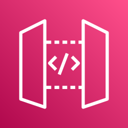
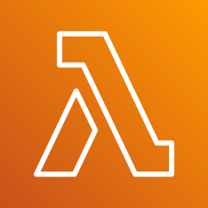
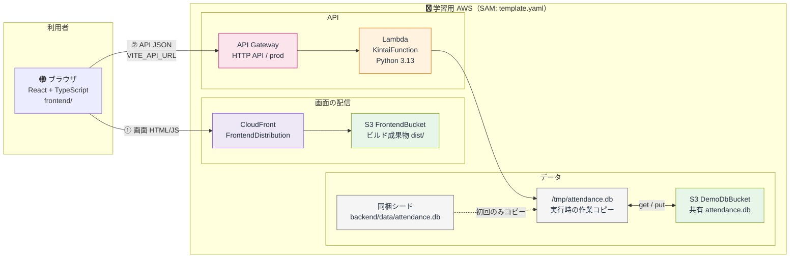
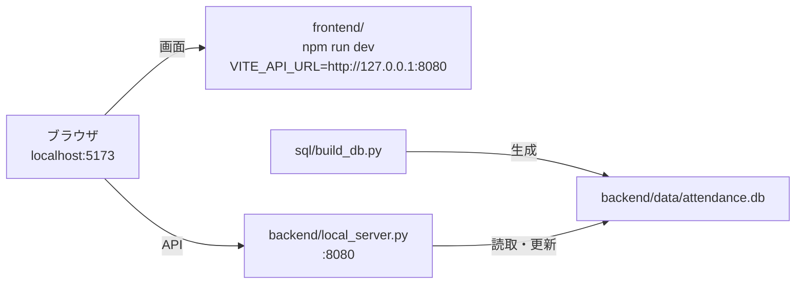

# 勤怠デモの構成図（研修用）

学習用の勤怠デモ（`wizway-kintai-demo`）。本番勤怠（`wizway_kintai`）とは別。  
**React + TypeScript + Python Lambda + HTTP API + 同梱 SQLite**。DynamoDB と RDS は使わない。

draw.io 版（AWS 公式アイコン）: [architecture.drawio](./architecture.drawio)（タブ「AWSデプロイ構成」「ローカル開発構成」）  
アイコン画像: [`assets/aws-icons/`](./assets/aws-icons/)

---

## 1. AWS デプロイ構成

画面と API は経路が分かれる。

### アイコン付きの流れ

| | | | | |
|:---:|:---:|:---:|:---:|:---:|
| <br/>ブラウザ<br/>React + TS | →①画面→ | <br/>CloudFront | → | <br/>S3<br/>FrontendBucket |
| <br/>ブラウザ<br/>React + TS | →②API→ | <br/>API Gateway<br/>HTTP API | → | <br/>Lambda<br/>Python 3.13 |

Lambda のデータ側:

| | | | |
|:---:|:---:|:---:|:---:|
| <br/>Lambda | → | <br/>/tmp SQLite<br/>（シードからコピー） | ⇄ <br/>S3 DemoDbBucket<br/>共有 attendance.db |

### Mermaid（構造）

プレビュー環境が Iconify に対応していれば、ノードにサービスアイコンが付く。



色は AWS アーキテクチャ図のカテゴリに寄せている（紫＝配信／ネットワーク、ピンク＝API Gateway、橙＝Lambda、緑＝S3）。

### 読み方

| 番号 | 何が起きるか |
|------|----------------|
| ① | CloudFront が S3 の静的ファイル（React のビルド）を返す。OAC でバケット直公開はしない |
| ② | ブラウザが HTTP API を呼び、Lambda が SQLite を読む／書く |

データまわりの要点:

- デプロイ物に含まれるのは**初期シード**の SQLite
- 実行時は `/tmp` に作業コピーを置く
- 更新は学習用アカウントの **S3 共有ファイル**へ書き戻し、次の読み取りからも見える

### 主な API

| 経路 | 役割 |
|------|------|
| `GET /employees` | ダミー社員一覧 |
| `GET /employees/{id}/months/{ym}` | 指定月の日ごと |
| `GET /employees/{id}/months/{ym}/summary` | 月の合計 |
| `PUT /employees/{id}/months/{ym}/days/{date}` | 1日を保存 |
| `GET /months/{ym}/overview` | 全員の合計 |
| `GET /months/{ym}/export` | CSV |
| `POST /login` / `POST /logout` | ログイン／ログアウト |
| `GET /demo/error` | 演習用の未処理エラー |

---

## 2. ローカル開発構成

AWS に載せない確認。S3 の共有 DB は使わない。

| | | |
|:---:|:---:|:---:|
| <br/>ブラウザ<br/>localhost:5173 | →画面→ | frontend/<br/>`npm run dev` |
| <br/>ブラウザ | →API→ | backend/`local_server.py`<br/>:8080 |
| | | ⇄ <br/>`backend/data/attendance.db` |



手順の目安:

1. `python sql/build_db.py`
2. `python backend/local_server.py`
3. `frontend` で `VITE_API_URL=http://127.0.0.1:8080` を付けて `npm run dev`

---

## 3. リポジトリの置き場

```text
backend/          Python Lambda（API + 同梱 SQLite）
frontend/         React + TypeScript（Vite）
sql/              表定義・シード・合計 SELECT
template.yaml     SAM（HTTP API + Lambda + S3 + CloudFront）
docs/             構成図・ルール・案件ドキュメント
openspec/         仕様と change
tests/e2e/        Playwright
```

---

## 4. 研修で押さえる一点

```text
ブラウザ ──画面──▶ CloudFront ──▶ S3（フロント）
       └──API───▶ HTTP API ──▶ Lambda ──▶ SQLite
                                      └─更新は S3 共有へ
```

本番勤怠と同じ AWS アカウントには載せない。Deployer は学習用アカウントだけ。
