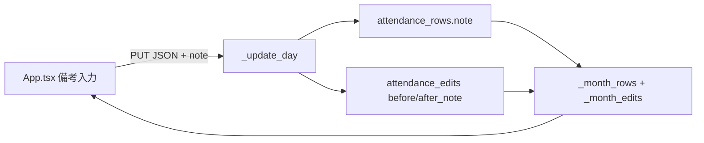

# 実装計画書 ― 日ごとの備考（メモ）

- 案件名: 日ごとの備考
- 作成日: 2026-11-18
- フェーズ: Plan（実装はこの文書の Phase / Step に従う）
- 仕様ソース: 同フォルダの `要件定義書.md`（唯一）
- 対象リポジトリ: wizway-kintai-demo

この案件では OpenSpec の change／specs は作らない（要件の対象外）。  
Build 開始後は、この文書の Phase / Step を上から順に進める。  
各 Step の完了時に、下のチェックリストを `- [x]` にする。

## 検証の理想パス

実装・ローカル確認のあとは、次の順を理想とする。前が通ってから次へ進む。

1. **ローカル E2E** … `npm run pw:test:attendance`（`PLAYWRIGHT_BASE_URL` 無し。webServer が API + Vite を起動）
2. **AWS デプロイ** … 学習用アカウントのみ。`sam build` / `sam deploy` → フロント build → S3 sync → CloudFront invalidate
3. **AWS E2E** … CloudFront を向けて同じ Playwright を回す  
   `$env:PLAYWRIGHT_BASE_URL='https://d266q7koncqwt6.cloudfront.net'; npm run pw:test:attendance`

ローカル E2E が赤のままデプロイしない。AWS E2E は共有 DB を書き換えるので、デプロイ直後の最終確認として使う。

## タスクチェックリスト

### Phase 1: DB・SQL

- [x] Step 1-1: スキーマ定義（`sql/schema.sql`）
- [x] Step 1-2: 月の行 SELECT（`sql/month_rows.sql` と `backend/sql/month_rows.sql` を一致）
- [x] Step 1-3: 実行時 DDL と既存 DB 移行（`backend/app.py`）

### Phase 2: API

- [x] Step 2-1: フィールド必須と備考検証
- [x] Step 2-2: 1日の保存と応答
- [x] Step 2-3: 月取得と編集履歴

### Phase 3: 画面

- [x] Step 3-1: 備考列と保存ボディ
- [x] Step 3-2: 編集履歴の文言

### Phase 4: テスト・デプロイ・受け入れ

- [x] Step 4-1: API テスト（`npm run test:api`）
- [x] Step 4-2: ローカル E2E（備考の保存→再表示）
- [x] Step 4-3: AWS デプロイ（学習用。ローカル E2E 緑のあと）
- [x] Step 4-4: AWS E2E（`PLAYWRIGHT_BASE_URL` を CloudFront に向けてパス）
- [x] Step 4-5: 受け入れの目安 1〜5（必要なら画面目視。AWS E2E 後が理想）

## 方針サマリ

既存の月の日ごと取得（GET）と 1 日保存（`PUT .../days/{date}`）に、備考 `note` を載せる。  
専用 API・CSV への備考列・合計計算への組み込み・SAM の新リソースは作らない。

## 変更ファイル一覧

| ファイル | 変更の有無 | 方針 |
|----------|------------|------|
| `sql/schema.sql` | あり | `attendance_rows` に `note TEXT`。`attendance_edits` に `before_note` / `after_note`（TEXT） |
| `sql/seed.sql` | なし（方針固定） | INSERT 列は現状のまま（`note` 省略 → NULL）。読み出しで `""` |
| `sql/month_rows.sql` | あり | 各日に `note`。未保存・NULL は `""` |
| `backend/sql/month_rows.sql` | あり | `sql/month_rows.sql` と同内容に揃える |
| `sql/month_summary.sql` | なし | 合計は変えない |
| `backend/sql/month_summary.sql` | なし | 同上 |
| `backend/app.py` | あり | `UPDATE_FIELDS`・DDL・移行・検証・保存・履歴・応答に `note` |
| `frontend/src/App.tsx` | あり | 型・下書き・「備考」列・`aria-label`・履歴文言 |
| `backend/tests/test_api.py` | あり | `day_payload` に `note`。備考の保存／拒否／履歴／CSV 不変 |
| `tests/e2e/attendance.spec.ts` | あり | 備考の保存→再表示を 1 ケース追加（`.js` は生成物なら TS に合わせる） |
| `template.yaml` | なし | 新リソースを足さない |
| CSV 出力（`_read_export`） | なし | ヘッダは現状の 6 列のまま（備考列なし） |

## ファイルごとの方針

### DB・SQL

- `attendance_rows.note` … その日の備考。API・画面の項目名は `note`、画面ラベルは「備考」
- `attendance_edits.before_note` / `after_note` … 成立した保存の前後
- 初期シードの既存行は `note` 無し（NULL）でよい。GET では空文字にする
- 実行時 SQL は `backend/sql/` 優先のため、`month_rows.sql` はリポ直下と backend 配下を必ず揃える

### DB 移行（既存ファイル・共有 DB）

従業員のパスワード列追加と同じく、`PRAGMA table_info` → `ALTER TABLE ... ADD COLUMN` を `_ensure_schema` 経路に足す。

1. `attendance_rows` に `note` が無ければ `ALTER TABLE attendance_rows ADD COLUMN note TEXT`
2. `attendance_edits` に `before_note` / `after_note` が無ければそれぞれ ADD
3. `ROWS_DDL` / `EDITS_DDL` を新定義に更新する
4. 区分制約のためのテーブル再作成パスでは、旧表に `note` があるときだけコピーし、無いときは NULL とする
5. ローカル同梱 DB は、Build 時に `sql/build_db.py` で作り直すか、起動時 ALTER に任せる

### API（`backend/app.py`）

- `UPDATE_FIELDS = ("category", "clock_in", "clock_out", "break_time", "note")`
- キー欠落の拒否文を「区分、出勤、退勤、休憩、備考をすべて送ってください」に更新する
- `null` は空文字。非文字列は「入力の形式が正しくありません」
- `len(note) > 100` は「備考は100文字以内にしてください」（Unicode コードポイント＝Python の `len(str)`）
- 区分・時刻の `_validate_fields` は維持。備考の内容で区分・時刻の可否は変えない
- 空の `note` は既存の時刻と同様 `_blank_to_null` で保存してよい。読み出しは `_blank` / `COALESCE` で `""`
- 月 GET の各行と PUT 成功応答に `note` を含める
- `_insert_edit` / `_month_edits` に before/after の note を含める
- 権限（401／403）と CSV・合計の契約は変えない

### 画面（`frontend/src/App.tsx`）

- 日ごとの表に「備考」列を出す。区分・出勤・退勤・休憩と同じ行の 1 行テキスト入力
- `aria-label` は `{日付} 備考`（例: `2026-11-02 備考`）
- `AttendanceRow` / `Draft` / `Edit` に `note`（履歴は `before_note` / `after_note`）
- `draftsFrom` と `saveDay` の JSON に `note` を含める（既存 PUT に載せる）
- `editText` は区分・時刻に加え、備考の前後が分かる日本語にする（備考だけ変わったときも分かる）
- 保存ボタン・保存中・保存拒否の表示は既存の 1 日保存と同じ扱い
- CSV・合計 UI は触らない

## 処理フロー（正常系）

### PUT（1日保存）

1. 認証・権限（未ログイン 401、他人かつ非管理者 403）
2. JSON を読む。`UPDATE_FIELDS` のキーがすべて揃っていること
3. 各値: `null` → `""`。非文字列なら拒否
4. `len(note) > 100` なら拒否
5. 既存 `_validate_fields`（区分・時刻）
6. 既存行があれば UPDATE、無ければ INSERT（`note` 含む）
7. 編集履歴に before／after の備考を残す
8. 共有 DB の公開（既存どおり）
9. 200 と保存後の `note`（空は `""`）

### GET（月の日ごと）

1. 各日の行に `note`（未保存・NULL → `""`）
2. `edits[]` に `before_note` / `after_note`（NULL → `""`）
3. `category` / 時刻 / `stored` / 既存履歴項目は壊さない

## 例外フロー

| 条件 | 期待 |
|------|------|
| `note` キーが無い（他キー欠落も含む） | 400。行は変えない。`区分、出勤、退勤、休憩、備考をすべて送ってください` |
| `note` が文字列でない | 400。行は変えない。`入力の形式が正しくありません` |
| `note` が 100 文字超 | 400。行は変えない。`備考は100文字以内にしてください` |
| 区分・時刻が既存ルールで不正 | 既存どおり拒否。備考の有無に関わらず行は変えない |
| 未ログイン／権限不足 | 既存どおり 401／403。行は変えない |

改行を含む文字列はそのまま保存してよい。画面は 1 行入力でよい。

## テスト観点

- 備考ありで保存 → 再取得で同じ文字列（改行を含む場合も）
- 備考を空文字に更新できる
- 101 文字は拒否され、行が変わらない
- `note` 欠落は拒否され、欠落メッセージに「備考」が含まれる
- 月取得の未保存日は `note` が `""`
- 編集履歴に備考の前後が残る
- CSV の列構成は変わらない（備考列が無い）
- 権限エラー時は備考も書き込まれない
- 既存の区分・時刻・合計・半休／有休テストは、`day_payload` に `note: ""` を足しても通る

## 受け入れの目安（要件より）

1. サンプル海原でログインし、空の日に通常出勤と備考「客先A」を保存できる
2. 月を読み直すと、その日の備考に「客先A」が出る
3. 備考を消して保存すると空になる
4. 101 文字の備考は保存できず、日本語の直し方が出る
5. 管理者で他人の日の備考を変えられる（既存の管理者権限の範囲）

## 触らないもの

- CSV 出力への備考列の追加
- 備考だけの単独 API
- 備考の全文検索、フィルタ、並び替え、画像・ファイル添付、承認フロー
- 合計（出勤日数・実働・超過・退勤なし件数）への組み込み
- OpenSpec の change／specs への登録
- `template.yaml` の新リソース
- 本番勤怠・MariaDB・DynamoDB・実在の個人情報

---

## Phase / Step（詳細）

各 Step の完了条件を満たしてから次へ進む。編集対象以外のファイルは変えない。  
進捗の正は上の「タスクチェックリスト」。ここは完了条件の説明。

### Phase 1: DB・SQL

#### Step 1-1: スキーマ定義

- 編集対象: `sql/schema.sql`
- 完了条件: `attendance_rows` に `note TEXT`、`attendance_edits` に `before_note` / `after_note` がある

#### Step 1-2: 月の行 SELECT

- 編集対象: `sql/month_rows.sql`、`backend/sql/month_rows.sql`
- 完了条件: SELECT に `note`（未保存・NULL は `""`）があり、両ファイルの内容が一致する

#### Step 1-3: 実行時 DDL と既存 DB 移行

- 編集対象: `backend/app.py`（`ROWS_DDL` / `EDITS_DDL` / `_ensure_schema` 周辺）
- 完了条件: 列の無い既存 DB でも起動後に ALTER され、備考列が使える。区分制約の再作成パスでも行が壊れない

### Phase 2: API

#### Step 2-1: フィールド必須と備考検証

- 編集対象: `backend/app.py`（`UPDATE_FIELDS`、`_update_day` の入力検証）
- 完了条件: `note` 必須。欠落／非文字列／101 文字超の reason が上記例外どおり。区分・時刻の既存検証は維持

#### Step 2-2: 1日の保存と応答

- 編集対象: `backend/app.py`（`_update_day` の SELECT／UPDATE／INSERT／200 応答）
- 完了条件: 備考が永続化され、成功応答の `note` が保存内容（空は `""`）と一致する

#### Step 2-3: 月取得と編集履歴

- 編集対象: `backend/app.py`（`_month_rows`、`_insert_edit`、`_month_edits`）
- 完了条件: 月の各行と `edits[]` に備考の前後が出る。未保存日の `note` は `""`

### Phase 3: 画面

#### Step 3-1: 備考列と保存ボディ

- 編集対象: `frontend/src/App.tsx`
- 完了条件: 表に「備考」列がある。入力の `aria-label` が `{日付} 備考`。下書きと PUT ボディに `note` が含まれる

#### Step 3-2: 編集履歴の文言

- 編集対象: `frontend/src/App.tsx`（`editText` と `Edit` 型）
- 完了条件: 履歴表示で備考の変化が日本語で分かる（区分・時刻だけの変化も、備考も変わったときも）

### Phase 4: テスト・デプロイ・受け入れ

#### Step 4-1: API テスト

- 編集対象: `backend/tests/test_api.py`
- 完了条件: 「テスト観点」をカバーする。`day_payload` 既定に `note` がある。既存テストが緑

#### Step 4-2: ローカル E2E

- 編集対象: `tests/e2e/attendance.spec.ts`（必要なら `.js`）
- 完了条件: 備考を入れて保存し、再表示で同じ文字列が見えるケースが 1 つ以上ある。`PLAYWRIGHT_BASE_URL` 無しで緑

#### Step 4-3: AWS デプロイ

- 編集対象: なし（学習用への載せ替え）
- 前提: Step 4-2 が緑
- 完了条件: 学習用アカウントへ API（SAM）とフロント（S3 / CloudFront）を載せた。本番箱には出さない

#### Step 4-4: AWS E2E

- 編集対象: なし（必要なら E2E が共有 DB の合計を壊さないようケースを調整）
- 前提: Step 4-3 完了。合計がシードと食い違うときは  
  `aws s3 cp backend/data/attendance.db s3://wizway-kintai-demo-db-655129713987/attendance.db --profile deploy-jisseki` で戻してから回す
- 完了条件: `PLAYWRIGHT_BASE_URL` を CloudFront（例: `https://d266q7koncqwt6.cloudfront.net`）に向けた `npm run pw:test:attendance` がパスする。終わったら共有 DB をシードに戻す

#### Step 4-5: 受け入れ確認

- 編集対象: なし（手動）
- 前提: Step 4-4 が理想。ローカルのみの暫定確認は可だが、案件完了は AWS E2E 後を正とする
- 完了条件: 「受け入れの目安」1〜5 を満たす
